# Backend File Flow

This document maps every backend source file: what it depends on, what depends on it, and where it sits in the build order. Read it before adding or changing backend code.

Paths are relative to `backend/`.

---

## The ordering rule

Every backend file has a **sequence number**. The rule is:

> A file's number is always higher than the numbers of the files it imports. The parent (the file others depend on) comes first, the child comes after it.

Example: `app/db.py` is **02** because it imports `app/config.py` (**01**). `app/models.py` is **03** because it imports `app/db.py`. Any file that imports `models.py` must have a number above 03.

Rules for numbering:

1. **Numbers are never reused or renumbered.** If a file is removed, its number stays empty.
2. **New files take the next free number** at the bottom of the list (currently the next number is **49**), in the feature section they belong to.
3. **Before adding a file, list its imports.** Every import must already have a lower number. If it doesn't, the design is wrong. Fix the design, not the order.
4. **Migrations are ordered by revision**, not by this list. Each new migration's `down_revision` is the previous revision (`0001` → `0002` → … ).
5. **Tests are not numbered.** They come after everything they test.

---

## Sequence and dependencies

| No. | File | Feature / phase | Imports from (must be lower numbers) | Used by (higher numbers) |
|---|---|---|---|---|
| 01 | `app/config.py` | Foundation (0) | none | 02, 05, 19, 20, 22, 23, 33, 35 |
| 02 | `app/db.py` | Foundation (0) | 01 | 03, 19, 20, 21, 22, 23 |
| 03 | `app/models.py` | Foundation (0), Chat (7) | 02 | 18, 19, 20, 21, 22, 35, 39, 40, `alembic/env.py` |
| 04 | `app/schemas.py` | Projects (1), Chat (7) | none (pydantic only) | 20, 21, 22, 40 |
| 05 | `app/search/es_client.py` | Foundation (0) | 01 | 23 |
| 06 | `app/ingestion/rules.py` | Folder upload (2) | none (reads `upload_rules.json`) | 20 |
| 07 | `app/ingestion/hashing.py` | Folder upload (2) | none | 20 |
| 08 | `app/ingestion/change_detection.py` | Re-upload (3) | none | 20 |
| 09 | `app/ingestion/parsers/base.py` | Parsing (4) | none | 10–16 |
| 10 | `app/ingestion/parsers/text.py` | Parsing (4) | 09 | 16 |
| 11 | `app/ingestion/parsers/markdown.py` | Parsing (4) | 09 | 16 |
| 12 | `app/ingestion/parsers/pdf.py` | Parsing (4) | 09 | 16 |
| 13 | `app/ingestion/parsers/docx.py` | Parsing (4) | 09 | 16 |
| 14 | `app/ingestion/parsers/code.py` | Parsing (4) | 09 | 16 |
| 15 | `app/ingestion/parsers/structured.py` | Parsing (4) | 09 | 16 |
| 16 | `app/ingestion/parsers/__init__.py` | Parsing (4) | 09–15 | 17, 19, tests |
| 17 | `app/ingestion/chunking.py` | Chunking (4) | 16 | 19, tests |
| 18 | `app/ingestion/status.py` | Background ingestion (4) | 03 | 19, 20 |
| 19 | `app/ingestion/worker.py` | Background ingestion (4), indexing (5) | 01, 02, 03, 16, 17, 18, **24, 25, 26** ⚠ | 20, 23, tests |
| 20 | `app/api/files.py` | Folder upload (2), re-upload (3), Explorer (4), ES delete (5) | 01, 02, 03, 04, 06, 07, 08, 18, 19, **24, 26** ⚠ | 21, 23 |
| 21 | `app/api/projects.py` | Projects (1), ES delete (5) | 02, 03, 04, 20, **24, 26** ⚠ | 23 |
| 22 | `app/api/meta.py` | Settings / ingestion indicator | 01, 02, 03, 04 | 23 |
| 23 | `app/main.py` | Foundation (0), updated each phase | 01, 02, 05, 19, 20, 21, 22, **30, 40** ⚠ | tests, uvicorn |
| 24 | `app/providers/embeddings.py` | Embeddings (5) | 01, **31** ⚠ | 19, 20, 21, 29, 30, 35, tests |
| 25 | `app/search/index_manager.py` | ES indexing (5) | 01, 05 | 19, 26, 27, 28, 29, 30, 35 |
| 26 | `app/search/indexer.py` | ES indexing (5) | 05, 25 | 19, 20, 21, 30, tests |
| 27 | `app/retrieval/bm25.py` | Retrieval Playground v1 (5) | 05, 25 | 28, 30, 32, 35 |
| 28 | `app/retrieval/vector.py` | Retrieval Playground v1 (5) | 05, 25, 27 | 30, 35 |
| 29 | `app/search/reconcile.py` | ES indexing (5) | 02, 03, 05, 24, 25 | 30, CLI, tests |
| 30 | `app/api/dev.py` | Dev tools (5), Playground v2 (6) | 01, 02, 03, 04, 24, 25, 26, 27, 28, 29, **34, 35** ⚠ | 23 |
| 31 | `app/providers/rate_limit.py` | Rate limiting (5) | 01 | 24, 36, 38, tests |
| 32 | `app/retrieval/fusion.py` | Hybrid retrieval (6) | 27 | 35, tests |
| 33 | `app/retrieval/reranker.py` | Hybrid retrieval (6) | 01 | 35, tests |
| 34 | `app/retrieval/selection.py` | Hybrid retrieval (6) | none | 35, `eval/*.py`, tests |
| 35 | `app/retrieval/pipeline.py` | Hybrid retrieval (6) | 01, 03, 24, 25, 27, 28, 32, 33, 34 | 30, 39, `eval/run.py`, tests |
| 36 | `app/providers/llm.py` | Chat (7) | 01, 31 | 39, tests |
| 37 | `app/generation/prompts.py` | Chat (7) | none | 38, 39, 40, tests |
| 38 | `app/generation/context_builder.py` | Chat (7) | 01, 31, 34, 37 | 39, tests |
| 39 | `app/generation/chat.py` | Chat (7) | 03, 35, 36, 37, 38 | 40, tests |
| 40 | `app/api/conversations.py` | Chat (7), citations (8), memory (9), Stop / Retry (10) | 01, 02, 03, 04, 37, 39, **44** ⚠ | 23 ⚠ |
| 41 | `app/retrieval/query.py` | Retrieval optimisation | none | 27 ⚠, 39 |
| 42 | `app/search/backfill.py` | Retrieval optimisation | 02, 03, 05, 25 | CLI |
| 43 | `app/generation/citations.py` | Citations (8) | 34 | 39 ⚠ |
| 44 | `app/generation/inspector.py` | Context Inspector (9, dev) | none | 39 ⚠, 40 |
| 45 | `app/generation/memory.py` | Conversation memory (9) | 01, 03, 31, 36, 37 | 39 ⚠ |
| 46 | `app/settings_store.py` | Settings (11) | 01, 03 | 23 ⚠, 47, tests |
| 47 | `app/api/settings.py` | Settings (11) | 01, 02, 03, 18, 24, 33, 36, 46 | 23 |
| 48 | `app/ingestion/reindex.py` | Re-indexing (11) | 02, 03, 05, 18, 24, 25, 26 | 21 ⚠, 47 |

⚠ **Ordering exception (Phases 5, 6 and 7).** Phase 5 makes already-numbered files (19, 20, 21, 23, and 24 via the rate limiter 31) import files that did not exist yet, so those imports point at *higher* numbers. Phase 6 does the same for `api/dev.py` (30), which gains the Playground v2 endpoint and imports the pipeline (35) and selection (34). Phase 7 does it once more: `main.py` (23) includes the chat router (40). Phases 8–11 and the retrieval optimisation add more of the same kind: `bm25.py` (27) imports the query helpers (41); `chat.py` (39) imports citations (43), the inspector (44) and memory (45); `conversations.py` (40) imports the inspector (44); `main.py` (23) imports `settings_store` (46) and the settings router (47); `projects.py` (21) imports `reindex` (48). Still no cycles. There are no import cycles (the graph below is still a DAG). Numbers were not changed, per rule 1. The cleanest fix is a one-time renumbering decided by the project owner; until then the rule is read as "no cycles, new files take the next number".

Package markers (`app/__init__.py`, `app/api/__init__.py`, `app/ingestion/__init__.py`, `app/search/__init__.py`, `tests/`) are empty, so they are not numbered.

### Migrations (order is fixed by `down_revision`)

| Revision | File | Feature | Depends on | Creates |
|---|---|---|---|---|
| 0001 | `alembic/versions/0001_baseline.py` | Foundation | none | baseline |
| 0002 | `alembic/versions/0002_projects.py` | Projects (1) | 0001 | `projects` |
| 0003 | `alembic/versions/0003_files.py` | Folder upload (2) | 0002 | `files` |
| 0004 | `alembic/versions/0004_chunks.py` | Chunking (4) | 0003 | `chunks` |
| 0005 | `alembic/versions/0005_conversations.py` | Chat (7) | 0004 | `conversations`, `messages` |
| 0006 | `alembic/versions/0006_memory_and_settings.py` | Memory (9), Settings (11) | 0005 | `conversations.summary`, `.summary_checkpoint_message_id`, `.recent_token_estimate`; `settings` |

`alembic/env.py` imports `app/models.py` (03), `app/config.py` (01) and `app/db.py` (02) so that Alembic sees every table.

### Tests (created after the code they test)

| File | Imports |
|---|---|
| `tests/conftest.py` | config, db, worker (19), main (23), embeddings (24), es_client (05), index_manager (25) |
| `tests/test_health.py` | main (23) |
| `tests/test_projects.py` | uses fixtures from `conftest.py` (no direct app imports) |
| `tests/test_files.py` | config, rules (06) |
| `tests/test_change_detection.py` | change_detection (08), hashing (07) |
| `tests/test_chunking.py` | chunking (17), parsers (16) |
| `tests/test_ingestion.py` | config, models (03), worker (19) |
| `tests/test_es_indexing.py` | config, models (03), embeddings (24), indexer (26), reconcile (29) |
| `tests/test_retrieval.py` | config, models (03), embeddings (24), bm25 (27), fusion (32), reranker (33), selection (34), pipeline (35) |
| `tests/test_chat.py` | config, models (03), rate_limit (31), llm (36, incl. the same-provider router), prompts (37), context_builder (38), chat (39), selection (34); fixtures in `conftest.py` (fake LLM, session-factory override) |
| `tests/test_chat_resilience.py` | config, models (03), chat (39), memory (45), inspector (44); citations in the stream, rate-limit notice, silent retries, inactivity timeout, fault injection, Retry / Cancel, Stop while waiting on the LLM, conversation delete, summarization |
| `tests/test_citations.py` | citations (43), selection (34) |
| `tests/test_query.py` | query (41), fusion (32): keyword extraction, follow-up resolution, the test-file prior |
| `tests/test_settings.py` | settings_store (46), reindex (48), models (03), embeddings (24), llm (36), indexer (26); masked / encrypted keys, validation, applied from the next call, re-index |

### Eval harness (not numbered, like tests)

| File | Imports |
|---|---|
| `eval/run.py` | config, db (02), models (03), worker (19), main (23), embeddings (24), pipeline (35), selection (34); data in `eval/dataset.json` and `eval/dataset_devdocs.json` |
| `eval/ablation.py` | config, db (02), models (03), embeddings (24), pipeline (35), reranker (33), selection (34), `eval/run.py` |
| `eval/experiments.py` | config, db (02), embeddings (24), pipeline (35), reranker (33), selection (34), `eval/run.py`, `eval/ablation.py` |
| `eval/rerankers.py` | db (02), models (03), reranker (33), `eval/ablation.py`, `eval/experiments.py` (reads the saved records; no pipeline call) |
| `eval/strategies.py` | selection (34), `eval/experiments.py`, `eval/rerankers.py` (replays saved records; no DB or API) |
| `eval/holdout.py` | config, db (02), embeddings (24), pipeline (35), reranker (33), selection (34), `eval/run.py`, `eval/ablation.py`, `eval/experiments.py` |
| `eval/bm25_variants.py` | config, db (02), embeddings (24), bm25 (27), fusion (32), pipeline (35), `eval/run.py` (cached query embeddings only; compares BM25-leg query variants and the test-file prior through the real pipeline) |
| `eval/context_headers.py` | db (02), models (03), embeddings (24), index_manager (25), pipeline (35), `eval/run.py` (scratch-index experiment: embed with a path / section header or not) |
| `eval/gate_band.py` | db (02), embeddings (24), pipeline (35), query (41), `eval/run.py` (does BM25 evidence separate answerable from off-topic questions inside the gate's band?) |
| `eval/llm_latency.py` | config, llm (36) (time to first token per Groq model for one real prompt) |

---

## Dependency graph

```mermaid
flowchart TD
    cfg["01 config.py"] --> db["02 db.py"]
    cfg --> es["05 es_client.py"]
    db --> models["03 models.py"]
    models --> status["18 status.py"]
    base["09 parsers/base.py"] --> parsers["10-15 format parsers"]
    parsers --> pinit["16 parsers/__init__.py"]
    pinit --> chunking["17 chunking.py"]
    cfg --> worker["19 worker.py"]
    db --> worker
    chunking --> worker
    status --> worker
    models --> worker
    rules["06 rules.py"] --> files["20 api/files.py"]
    hashing["07 hashing.py"] --> files
    changed["08 change_detection.py"] --> files
    status --> files
    worker --> files
    schemas["04 schemas.py"] --> files
    files --> projects["21 api/projects.py"]
    schemas --> projects
    schemas --> meta["22 api/meta.py"]
    files --> main["23 main.py"]
    projects --> main
    meta --> main
    worker --> main
    es --> main
    cfg --> emb["24 providers/embeddings.py"]
    cfg --> rl["31 providers/rate_limit.py"]
    rl --> emb
    cfg --> idxm["25 search/index_manager.py"]
    es --> idxm
    es --> indexer["26 search/indexer.py"]
    idxm --> indexer
    es --> bm25["27 retrieval/bm25.py"]
    idxm --> bm25
    bm25 --> vec["28 retrieval/vector.py"]
    idxm --> vec
    db --> recon["29 search/reconcile.py"]
    models --> recon
    emb --> recon
    idxm --> recon
    emb --> worker
    idxm --> worker
    indexer --> worker
    emb --> files
    indexer --> files
    emb --> projects
    indexer --> projects
    emb --> dev["30 api/dev.py"]
    indexer --> dev
    bm25 --> dev
    vec --> dev
    recon --> dev
    schemas --> dev
    models --> dev
    dev --> main
    bm25 --> fusion["32 retrieval/fusion.py"]
    cfg --> rr["33 retrieval/reranker.py"]
    sel["34 retrieval/selection.py"]
    cfg --> pipe["35 retrieval/pipeline.py"]
    models --> pipe
    emb --> pipe
    idxm --> pipe
    bm25 --> pipe
    vec --> pipe
    fusion --> pipe
    rr --> pipe
    sel --> pipe
    pipe --> dev
    sel --> dev
    cfg --> llm["36 providers/llm.py"]
    rl --> llm
    prompts["37 generation/prompts.py"]
    cfg --> cb["38 generation/context_builder.py"]
    rl --> cb
    sel --> cb
    prompts --> cb
    models --> chat["39 generation/chat.py"]
    pipe --> chat
    llm --> chat
    prompts --> chat
    cb --> chat
    db --> conv["40 api/conversations.py"]
    models --> conv
    schemas --> conv
    prompts --> conv
    chat --> conv
    conv --> main
    cfg --> conv
    query["41 retrieval/query.py"] --> bm25
    query --> chat
    db --> backfill["42 search/backfill.py"]
    models --> backfill
    es --> backfill
    idxm --> backfill
    sel --> cites["43 generation/citations.py"]
    insp["44 generation/inspector.py"]
    cfg --> mem["45 generation/memory.py"]
    models --> mem
    rl --> mem
    llm --> mem
    prompts --> mem
    cites --> chat
    insp --> chat
    mem --> chat
    insp --> conv
    cfg --> sstore["46 settings_store.py"]
    models --> sstore
    sstore --> sapi["47 api/settings.py"]
    status --> sapi
    emb --> sapi
    rr --> sapi
    llm --> sapi
    sapi --> main
    sstore --> main
    db --> reidx["48 ingestion/reindex.py"]
    models --> reidx
    status --> reidx
    emb --> reidx
    idxm --> reidx
    indexer --> reidx
    es --> reidx
    reidx --> projects
    reidx --> sapi
    fusion --> pipe
```

---

## What each file does

Each entry gives the file's job and the one thing a reader needs to know about it.

### Foundation (phase 0)

- **01 `app/config.py`**: one `Settings` object loaded from the repo-root `.env`. Holds `database_url`, `elasticsearch_url`, `cors_origins`, `dev_mode` and `data_dir` (where uploads are stored). Everything reads settings from here.
- **02 `app/db.py`**: the async SQLAlchemy engine, `SessionLocal` factory, `Base` class and the `get_session` FastAPI dependency. Also `ping_postgres` for the health check.
- **03 `app/models.py`**: the six tables: `Project`, `File`, `Chunk`, `Conversation` (with its summary and checkpoint), `Message`, `AppSettings`. This is the database schema as code. Alembic migrations must match it.
- **05 `app/search/es_client.py`**: the shared Elasticsearch client and `ping_elasticsearch`. Other modules read it as `es_client.es` (attribute lookup at call time) so tests can swap in a per-test client.

### Projects (phase 1)

- **04 `app/schemas.py`**: Pydantic request and response models (`ProjectCreate`, `FileOut`, `UploadReport`, `ChunkOut`, and so on). These define the API's JSON shapes.
- **21 `app/api/projects.py`**: CRUD for projects, plus `GET /projects/{id}/overview`. It imports `project_dir` from `files.py` (20), which is why it comes after it.

### Folder upload, re-upload and Explorer (phases 2–4)

- **06 `app/ingestion/rules.py`**: decides what is accepted. It normalises paths, rejects unsupported or oversized files, and classifies each file as `source`, `doc`, and so on, with its language. Rules live in `upload_rules.json` next to the file.
- **07 `app/ingestion/hashing.py`**: `copy_and_hash` streams an upload to disk while computing its SHA-256 in one pass.
- **08 `app/ingestion/change_detection.py`**: `diff(old, new)` compares stored hashes with the incoming hashes and returns `created`, `modified`, `deleted` and `unchanged`. It has no I/O.
- **20 `app/api/files.py`**: the upload endpoint (`POST /projects/{id}/upload`), file listing, file content, replace, delete, retry and chunk listing. It is the hub of the ingestion flow: it stages uploads, applies the diff, updates rows, then calls `worker.enqueue`.

### Background ingestion (phase 4)

- **09 `app/ingestion/parsers/base.py`**: the shared output types. `ParsedDocument` and `Segment` are what every parser returns, plus `ParseError` and helpers (`decode`, `whole_file`, `line_count`).
- **10–15 format parsers**: each turns bytes into a `ParsedDocument`. `text.py`, `markdown.py`, `pdf.py`, `docx.py`, `code.py` (Python split by `ast` nodes; other languages are passed on as whole text) and `structured.py` (JSON, YAML, CSV).
- **16 `app/ingestion/parsers/__init__.py`**: `parse(...)` picks the parser from the file extension and `file_type`. This is the only parser entry point other code uses.
- **17 `app/ingestion/chunking.py`**: splits a `ParsedDocument` into chunks sized by `MAX_CHUNK_TOKENS` (800) with `OVERLAP_TOKENS` (100). It never looks at the file format; it only sees segments.
- **18 `app/ingestion/status.py`**: `refresh_project_status` derives a project's status from its files' statuses. Nothing sets a project's status directly.
- **19 `app/ingestion/worker.py`**: the in-process background consumer. `enqueue` schedules a project. `process_project` moves each pending file through `pending → processing → ready | failed`. `start()` runs at app startup and re-queues files left in `processing` after a crash.

### Embeddings, ES indexing and dev tools (phase 5)

- **24 `app/providers/embeddings.py`**: `EmbeddingProvider` protocol and `GeminiEmbeddingProvider` (REST via `httpx`). Batches documents (`RETRIEVAL_DOCUMENT`), embeds questions (`RETRIEVAL_QUERY`), retries on HTTP 429 / 5xx with backoff and honours `Retry-After`. `fingerprint` is `provider:model:dims`. `set_embedding_provider` lets tests install a fake.
- **25 `app/search/index_manager.py`**: index name per fingerprint (`{ES_INDEX_PREFIX}-{fingerprint slug}`), the code-aware analyzer (`standard` tokenizer + `word_delimiter_graph` with `preserve_original`) and the strict mapping with `dense_vector` (cosine) plus the searchable `path_text` and `section` fields. `ensure_index` creates the index on first use and adds those two fields to an index created before they existed.
- **26 `app/search/indexer.py`**: bulk index (`refresh=wait_for`), `delete_file_docs`, `delete_project_docs`, `count_docs`, `count_by_file`, `get_vectors`. A missing index counts as zero docs, never an error.
- **27 `app/retrieval/bm25.py`** and **28 `app/retrieval/vector.py`**: the two retrieval legs. Both put the isolation filter (`project_id` + READY `file_id`s) inside the query itself, and return no hits when the project has no READY file. The BM25 leg searches stopword-stripped terms (41) on `content`, `path_text` and `section`.
- **29 `app/search/reconcile.py`**: `find_orphans` (ES `file_id`s Postgres no longer has) and `reconcile`, also runnable as `python -m app.search.reconcile` from `backend/`.
- **30 `app/api/dev.py`**: `GET /projects/{id}/es-inspector`, `/es-count`, `/retrieval-playground?q=` `/retrieval-pipeline?q=&gate=&cutoff=` (Playground v2: every pipeline stage, the gate decision, optional gate and cut-off overrides) and `/files/{file_id}/vectors` (vector peek, `?full=true` returns every value). All five answer 404 unless `DEV_MODE=true`; the vector peek also 404s when the file belongs to another project. `es-count` works for a project that no longer exists in Postgres.

### Hybrid retrieval (phase 6)

- **32 `app/retrieval/fusion.py`**: `rrf_fuse(bm25, vector, k=60)`: pure Reciprocal Rank Fusion. One entry per chunk, remembering its rank in each leg and its vector similarity (the gate and filter read it). `apply_test_prior(fused, question, factor)` multiplies the score of test-file chunks by `RETRIEVAL_TEST_PATH_FACTOR` (0.8) unless the question is about tests.
- **33 `app/retrieval/reranker.py`**: `Reranker` protocol (`score(query, passages) -> list[float]`), `CrossEncoderReranker` (fastembed ONNX, lazy-loaded, run in a thread; the model downloads on first use) and a `JevReranker` stub (base URL, model and key are configurable and stored; `ping` and `score` raise until its API details are provided). `set_reranker` lets tests install a fake. The reranker is optional (off by default); the pipeline only calls it when `RERANK_TOP_N > 0`.
- **34 `app/retrieval/selection.py`**: pure functions over `Candidate`s. `gate_passes(top_vector_score, threshold)` is the refusal gate. `relative_filter(ordered, best, cutoff, bm25_protect)` keeps chunks within `cutoff` of the best vector similarity or among the best BM25 hits, and marks the rest `dropped_by="relative"`. `select(ranked, threshold, top_k, token_budget)` does overlap cleanup (same file, overlapping line ranges, the better chunk wins), then Top-K and the ~3k-token budget in serving order; its rerank-score `threshold` only applies to candidates the optional reranker scored. Every candidate is tagged with the stage that dropped it (`gate`, `relative`, `threshold`, `overlap`, `top_k`, `budget`), so the Playground and the eval can replay any setting.
- **35 `app/retrieval/pipeline.py`**: `run(...)` returns a full `RetrievalTrace` of every stage (gate input and decision, candidates in serving order); `retrieve(...)` is what chat calls and returns the final chunks (each tagged with its `file_type` for citations) or `NoRelevantContext(reason)`. Keyword overrides (`gate_threshold`, `relative_cutoff`, `rerank_top_n`) default to the settings. ES calls get limited retries (connection errors, 429, 502-504); an exhausted retry, an embedding failure or a rerank failure raises `RetrievalError`.
- **`eval/run.py`** (not numbered): `python -m eval.run` from `backend/`. Evaluates either a throwaway ingest of the sample project (`dataset.json`) or an already ingested project (`dataset_devdocs.json`, `existing_project`). Embeds queries once (disk cache in `eval/.cache/`, stops cleanly on a quota error), runs each question through the pipeline with the gate and filter off, then replays the gate, the relative filter and `select` offline over a grid of gate thresholds. Reports hit rate, Recall@5, MRR, off-topic refusal, a tune/holdout split, a bootstrap range for the best gate, a cut-off table, per-tag results, borderline questions and every miss/leak. Imports: config, db (02), models (03), worker (19), main (23), embeddings (24), pipeline (35), selection (34).
- **`eval/ablation.py`, `eval/experiments.py`, `eval/rerankers.py`, `eval/strategies.py`** (not numbered): offline analyses behind [Retrieval.md](Plan/Retrieval.md) and [Retrieval-Ablation.md](Reports/Retrieval-Ablation.md). `experiments` records every candidate with all its scores once (`eval/.cache/pipeline_records.json`); `rerankers` scores the RRF top 10 with each candidate reranker model; `strategies` replays 2,222 complete pipelines with 5-fold cross-validation. None of them call the embedding API. `ablation` covers the first pipeline's stages and the shipped gate and filter stages (hit, Recall@5, MRR, refusal, relevant share per stage, by question type); it runs live through the pipeline or, with `--reuse`, from saved candidate pools in seconds, and `--save` writes them.
- **`eval/holdout.py`** (not numbered): `python -m eval.holdout` runs a frozen question set (`dataset_devdocs_holdout.json`) that was not used to choose any setting. It refuses to run unless the configured gate, cut-off, BM25 protect and reranker settings equal the values frozen in the dataset file. It embeds each new question live and timed (one Gemini call per new question), compares the new pipeline with the first Phase 6 pipeline on the same recorded candidates, checks the replay against the real pipeline, and reports end-to-end latency p50 / p95.

### Chat (phase 7)

- **36 `app/providers/llm.py`**: `LLMProvider` protocol and `OpenAICompatLLMProvider` (the `openai` SDK; Groq and Gemini differ only in base URL, key, model and the output-token parameter name, chosen by `LLM_PROVIDER`). `stream(messages, max_output_tokens=None)` first calls `limiter.acquire(requests=1, tokens=prompt estimate + max output tokens)` on the shared `groq_llm` / `gemini_llm` limiter, then yields **only content tokens** (reasoning deltas are dropped), asks the provider for usage and, when the stream ends, **settles** the reservation to the tokens really used. `wait_estimate(messages)` reports how long the limiter would make this call wait. SDK retries (`LLM_MAX_RETRIES`) cover 429 / 5xx before the first token; any SDK error becomes `LLMError`. `RoutingLLMProvider` wraps the primary Groq model with a fallback Groq model that has its own limiter (`groq_llm_fallback`): a call goes to the fallback only when the primary would wait longer than `LLM_FALLBACK_WAIT_SECONDS` and the fallback would wait less. `set_llm_provider` lets tests install a fake.
- **37 `app/generation/prompts.py`**: the system prompt (scope guardrail, strict grounding, adaptive Markdown, "Simplified example" labelling, context-is-data rule), the fixed no-context and generic-error texts, and `title_from_question` (the application-side conversation title, no LLM call).
- **38 `app/generation/context_builder.py`**: `build_messages(question, chunks, history, summary)` returns the system prompt (with the conversation summary appended when there is one) + recent messages after the summary's checkpoint (capped by `CHAT_HISTORY_MESSAGES` and `CHAT_HISTORY_TOKENS`, newest win) + one user message holding the labelled retrieved context (`--- path, lines a-b ---`, trailing whitespace and blank-line runs removed to save tokens) and the question.
- **39 `app/generation/chat.py`**: `stream_answer(...)`, an async generator of `Event`s (`[waiting]`, `token`*, `sources`, then `done` | `no_context` | `error`), independent of HTTP. It loads memory (45), resolves a follow-up into a self-contained retrieval query (41), runs fresh retrieval for every question, skips the LLM on `NoRelevantContext`, builds citations (43) and the prompt (38), records the prompt for the dev inspector (44), announces a rate-limit wait, and retries a failure before the first token silently (`GENERATION_RETRIES`). The LLM runs in a producer task behind a queue with an inactivity timeout, so a Stop cancels cleanly even mid-wait. The assistant message (with frozen `sources_json`) and `gen_state=answered` are saved in one transaction only after the stream completes; `failed` or `stopped` are recorded otherwise. Dev fault flags (`FAULT_LLM`, `FAULT_RETRIEVAL`) are honoured only with `DEV_MODE=true`. Short sessions per step, so no connection is held while the LLM streams.
- **40 `app/api/conversations.py`**: `GET /projects/{id}/conversations`, `GET /conversations/{id}` (restore, no LLM), `POST /projects/{id}/conversations` (first message: creates the conversation) and `POST /conversations/{id}/messages`. Both POSTs validate (`ChatRequest`: 1 to 8,000 characters after trimming), require at least one READY file (409 otherwise), save the user message (`gen_state=pending`), and stream SSE: `conversation`, `token`*, then `done` | `no_context` | `error`. Errors carry only the generic text. Uses `get_session_factory` (02) for the stream's own sessions. Also: `DELETE /conversations/{id}` (messages go, project files and chunks stay), `POST /messages/{id}/retry` (same user message, fresh retrieval and LLM; only for the newest message when `failed` or `stopped`), `POST /messages/{id}/dismiss` (Cancel: `gen_state=dismissed`) and the dev-only `GET /conversations/{id}/context`.

### Retrieval optimisation, citations, memory, settings (phases 8–11)

- **41 `app/retrieval/query.py`**: pure query preparation. `keyword_query` strips stopwords for BM25; `is_follow_up` / `retrieval_query` add the previous question to a follow-up that contains a reference word (it, that, this, …), never to a merely short question.
- **42 `app/search/backfill.py`**: `python -m app.search.backfill` fills `path_text` and `section` on documents indexed before those fields existed. No embeddings are computed.
- **43 `app/generation/citations.py`**: `build_citations(chunks)`: sources in retrieval order, grouped by file, each line range kept separate, exact duplicates removed; source files show line ranges, other files the path only. Output is stored in `messages.sources_json`.
- **44 `app/generation/inspector.py`**: in-memory store of each conversation's latest prompt (bounded, dev-only reads).
- **45 `app/generation/memory.py`**: after each saved answer, counts the tokens after the summary's checkpoint and, past `SUMMARY_THRESHOLD_TOKENS`, folds older exchanges into `conversations.summary` in a background task (same LLM wrapper, so the same rate-limit window), keeping the newest `SUMMARY_KEEP_MESSAGES` verbatim. A failure leaves the previous summary in place.
- **46 `app/settings_store.py`**: the editable settings (`SettingsPatch`, range-checked), Fernet encryption of API keys with `data/secret.key`, masked read view, and `load_overrides` / `save`, which apply values to the running `settings` object and reset the provider caches so changes take effect from the next call.
- **47 `app/api/settings.py`**: `GET /settings`, `PUT /settings`, `POST /settings/test` (unsaved form values may be tested; failure text is always generic) and `sync_reindex_flags`, which marks projects embedded with another fingerprint `needs_reindex` (and releases them when the fingerprint matches again).
- **48 `app/ingestion/reindex.py`**: `start(project_id, sessions)` runs a background re-embed of a project's stored chunks into the current fingerprint's index with the same chunk ids; chunks already in the new index are skipped, so an interrupted run resumes; the project switches fingerprint only when every chunk is in, then the old index's docs are removed.

### Rate limiting (phase 5, shared by every provider)

- **31 `app/providers/rate_limit.py`**: provider-agnostic client-side limiting. `SlidingWindowLimiter` (rolling window; `acquire` returns a reservation, `settle` corrects its cost to the real one, `wait_estimate` reports the wait without reserving), `RateLimiter` (requests-per-minute + tokens-per-minute), `batch_by_budget` (split by item count and token cap) and `get_limiter(key)`. A provider asks for its limiter by key (`gemini_embedding`, `gemini_llm`, `groq_llm`, `groq_llm_fallback`); limits come from settings (`{KEY}_RPM` / `{KEY}_TPM` in `.env`, 0 = unlimited), and one limiter per key is shared process-wide. A new provider needs only a new key and two settings. One batch may use at most 25% of a minute's token budget.

### App wiring

- **22 `app/api/meta.py`**: `GET /config` (exposes `dev_mode`) and `GET /ingestion/active` (drives the global ingestion indicator).
- **23 `app/main.py`**: creates the FastAPI app, runs the lifespan (applies saved settings over `.env`, flags projects that need a re-index, starts the worker, closes Elasticsearch and the DB engine on shutdown), adds CORS, includes the six routers (projects, files, meta, conversations, settings, dev) and defines `GET /health`.

---

## Runtime flows

### Startup

1. `main.py` (23) builds the app; `lifespan` runs.
2. Saved settings are applied over `.env` (46) and projects embedded with another fingerprint are flagged `needs_reindex` (47).
3. `worker.start()` (19) resets `processing` files to `pending`, then enqueues every project that has pending files.
4. The health check (`/health`) pings Postgres (02) and Elasticsearch (05).

### Folder upload

1. `POST /projects/{id}/upload` hits `files.upload` (20).
2. Each file is checked by `rules` (06), then streamed to a staging folder with `copy_and_hash` (07).
3. Stored rows are compared with incoming hashes by `diff` (08).
4. Deleted, modified and created files are updated in `files.py`, using `models` (03) and `schemas` (04).
5. `refresh_project_status` (18) runs and the session commits.
6. If anything was created or modified, `worker.enqueue` (19) schedules the project.

### Ingestion job

1. `worker._consume` takes a project id from the queue.
2. `process_project` picks the next pending file, marks it `processing` and commits.
3. `_ingest_file` runs `parse` (16) and `chunk_document` (17) in a thread.
4. **Postgres first:** it deletes that file's old chunks, inserts the new ones and commits (the file is still `processing`).
5. **Then ES:** `ensure_index` (25), delete the file's old docs, `embed_documents` (24), bulk index (26) with `refresh=wait_for`.
6. Only then is the file set to `ready` (and the project's `embedding_fingerprint` stored). Any parse, embed or ES error sets it to `failed` and removes its chunks and ES docs, so a failed file never leaves anything searchable.
7. The project status is refreshed (18) and the loop repeats until no pending files remain.

### Delete (file, re-upload that drops a file, project)

1. Postgres rows are deleted and committed first (chunks cascade).
2. `delete_by_query` on `file_id` (or `project_id`) removes the ES docs, using the project's stored fingerprint.
3. An ES failure is logged and does not fail the user's request: retrieval intersects with Postgres READY ids, so stray docs can't be returned, the ES Inspector lists them under Orphans, and `reconcile` removes them.

### Retrieval Playground v1

1. `dev.py` (30) loads the project's READY file ids from Postgres (never from the client).
2. BM25 (27) and vector (28) run with that filter inside the query; the question is embedded with `embed_query` (24). If embedding fails, BM25 results are still returned with `vector_error`.

### Retrieval pipeline (Phase 6)

1. `pipeline.run` (35) loads the project's READY file ids from Postgres and the index fingerprint. No READY files or an empty query returns an empty trace with no ES or embedding call.
2. BM25 (27, stopword-stripped terms over content, path and section) and `embed_query` (24, LRU-cached, keep-alive connection) + kNN (28) run concurrently, each ES call inside `_with_retries`. Both carry the isolation filter.
3. `rrf_fuse` (32) merges the lists, then `apply_test_prior` (32) demotes test-file chunks unless the question is about tests. Chunk rows are read from Postgres joined to READY files, so an ES doc with no READY Postgres row is discarded here.
4. The gate (`gate_passes`, 34) compares the best vector similarity with `GATE_VECTOR_THRESHOLD`. Below it the candidates are tagged `gate` and the result is `NoRelevantContext`; nothing further runs (no reranking cost on a refused question).
5. Optional: if `RERANK_TOP_N > 0` the reranker (33) scores `"{file_path}\n{content}"` for the first N candidates and they are served first in score order.
6. `relative_filter` (34) keeps chunks within `RELATIVE_CUTOFF` of the best vector similarity or among the best `BM25_PROTECT` BM25 hits; `select` (34) applies overlap cleanup, Top-K and the token budget. An empty result is `NoRelevantContext`.

### Chat turn (Phases 7–10)

1. `conversations.py` (40) validates the body, requires a READY file and a project that does not need a re-index, creates the conversation on the first message (title from `title_from_question`, 37) and saves the user message with `gen_state=pending`; then it streams `chat.stream_answer` (39) as SSE, starting with `conversation`. Retry re-enters here with the existing user message.
2. `stream_answer` loads the summary and the messages after its checkpoint (45), turns a follow-up into a self-contained query (41) and calls `retrieve` (35).
3. `NoRelevantContext`: the fallback text is saved as the assistant message, `gen_state=answered`, `no_context` is sent, and the log says `LLM not called`. The LLM provider (36) is never touched.
4. Otherwise citations are built (43), `build_messages` (38) assembles the prompt (summary + recent messages + labelled context + question) and the prompt is recorded for the dev inspector (44). If the provider's limiter would make the call wait, a `waiting` event carries the seconds. The router (36) picks the primary or the fallback Groq model; the call settles its token reservation to real usage when it ends.
5. Content tokens are forwarded as `token` events. A failure before the first token is retried silently once; silence longer than `LLM_INACTIVITY_SECONDS` counts as a failure.
6. After the last token: assistant message (+ frozen `sources_json`) and `gen_state=answered` are saved together, memory is scheduled in the background (45), then `sources` and `done`. A retrieval or LLM failure sends `error` (generic text), sets `gen_state=failed` and saves no assistant message; a client disconnect (Stop) sets `gen_state=stopped`.
7. Opening a conversation (`GET /conversations/{id}`) reads Postgres only.

### Settings and re-index (Phase 11)

1. `PUT /settings` (47) validates (46), encrypts any API key, stores the row, applies values to `settings`, and drops the provider caches; the next question uses them.
2. If the embedding model or dimensions changed, every project with another fingerprint becomes `needs_reindex`: chat, upload, replace and retry answer 409 for it.
3. `POST /projects/{id}/reindex` (21) starts `reindex` (48): embed stored chunks in slices through the shared limiter into the new index, same chunk ids, skipping ids already there.
4. When every chunk is in, the project's fingerprint and status are switched, then the old index's docs for the project are removed. On error the project stays `needs_reindex` and the job can be run again.

### Key design property

- The worker (19) never imports the API layer, so ingestion can run without HTTP. Keep it that way.

---

## Adding a feature

1. Find the highest number in the table above (currently **48**).
2. List each new file's imports. Use only files already in the table, or new files you number before the file that imports them.
3. Assign the next free numbers in dependency order. Parents first, children after.
4. Add the rows to the table, the graph and the "What each file does" section of this document, in the same edit.
5. If the feature changes the schema, add a new migration whose `down_revision` is the latest revision (currently `0006`; Phases 5 and 6 added no migration), and add its row to the migrations table.
6. Keep `Docs/Plan/Diagrams/` in sync, as CLAUDE.md requires.

---

## Observations

These are things the code shows today. They are not bugs in the Phase 4 scope.

- **Files that were `ready` before Phase 5 have no ES docs.** Re-uploading an unchanged folder skips them (same hash), so they show Postgres N / ES 0 in the ES Inspector. Delete and re-upload the project (or retry / replace each file) to index them.
- **Embeddings use `httpx` against Gemini's REST API**, not the `google-genai` SDK the plan names. It is the same call `scripts/check_providers.py` verifies and adds no dependency. Swapping to the SDK touches only file 24.
- **`project_dir` lives in `api/files.py`** (20), so `api/projects.py` (21) depends on the upload API to get a path helper. When the worker or another module needs it too, move it to `config.py` (01) or a small `paths.py` placed before 19.
- **`Chunk` is defined twice**: a dataclass in `ingestion/chunking.py` (17) and an ORM model in `models.py` (03). They are different things, but the same name makes imports easy to confuse.
