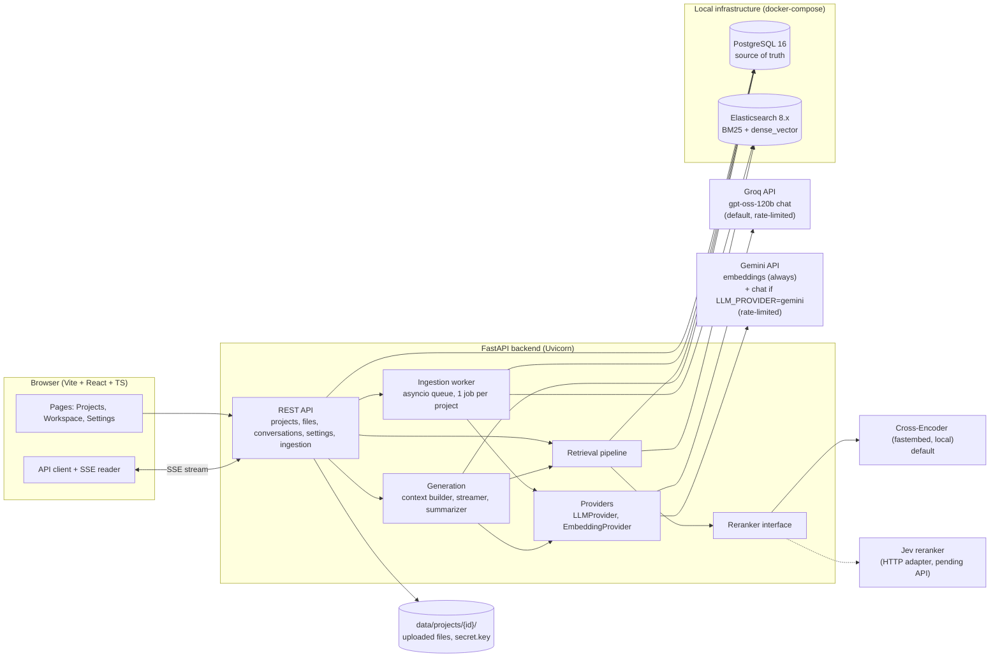

# 01 — System Architecture

Runtime components of DevDocs V1 (local, single-user). Source: [Implementation Plan](../DevDocs-V1-Implementation-Plan.md) → Tech Stack.

**Notes**
- Postgres holds projects, files, chunk text, conversations, messages and settings; Elasticsearch holds only the searchable index.
- Application code never imports the Groq/OpenAI or Gemini SDKs directly; it goes through the provider wrappers.
- Infrastructure cost is ₹0; only the Groq (chat) and Gemini (embedding) API calls are metered and rate-limited.

## Explanation

DevDocs runs entirely on the user's machine, in three layers.

- **Browser.** A React app with the Projects, Workspace and Settings pages. It calls the backend over REST and reads chat answers as a live SSE stream.
- **FastAPI backend.** The REST API hands work to four parts:
  - the ingestion worker, which parses, chunks, embeds and indexes uploaded files in the background;
  - the retrieval pipeline, which finds relevant chunks for a question;
  - generation, which builds the prompt and streams the answer;
  - the providers, a thin wrapper around Groq (chat) and Gemini (embeddings) so no other code talks to them directly.
- **Local infrastructure.** Postgres is the source of truth for projects, files, chunk text, chats and settings. Elasticsearch only serves search, doing both keyword (BM25) and vector lookups. Uploaded files sit on disk under `data/`.

**Question flow.** The API calls retrieval, which queries Elasticsearch and checks the results against Postgres. The results are reranked, by the local cross-encoder by default or by Jev if it is selected. Generation then sends the best chunks and the question to Groq and streams the answer back.

**Upload flow.** Files are saved to disk and queued. The worker writes chunks to Postgres, gets vectors from Gemini, and indexes them in Elasticsearch.

The only external pieces are the Groq and Gemini APIs. Everything else is local and free.
