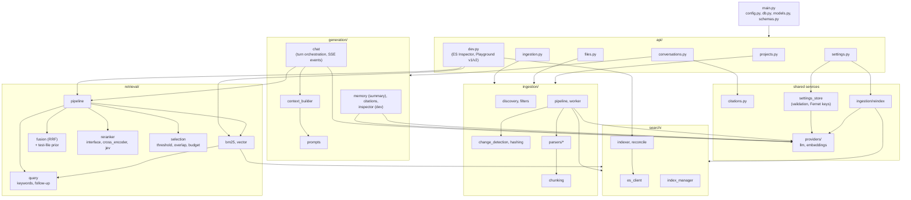

# 02 — Backend Module Map

Package layout under `backend/app/` and the allowed dependency direction. Source: Plan → Repository Layout.

**Rules**
- `api/` is thin: validate, call a service, return.
- `retrieval/` and `generation/` never touch the Groq/OpenAI or Gemini SDKs; only `providers/` does.
- `change_detection.diff()` and `citations.py` are pure functions, so they are unit-testable without infrastructure.
