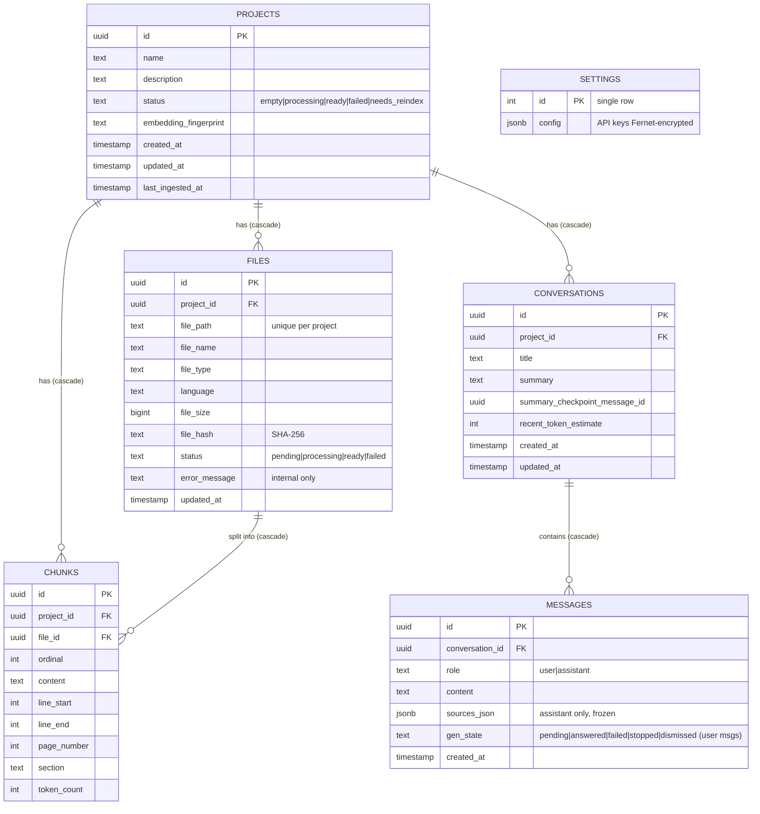
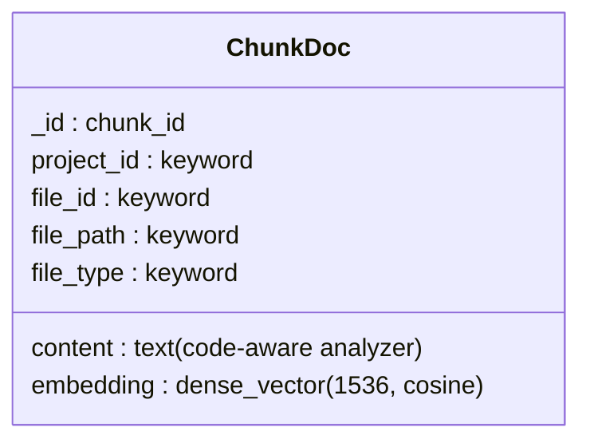
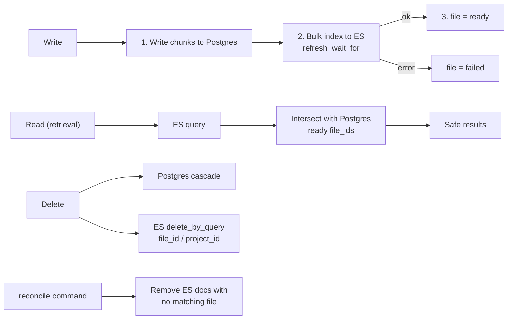

# 03 — Data Model

PostgreSQL schema and the Elasticsearch document. Source: Plan → Data Model.

## PostgreSQL

## Elasticsearch document

Index name: `devdocs-chunks-{fingerprint}` (one per provider + model + dimensions).

## Postgres ↔ ES consistency

