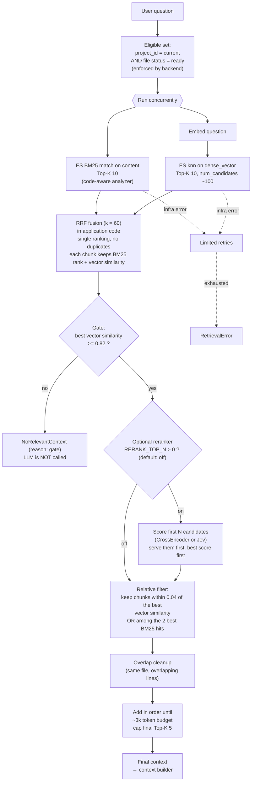

# 05 — Retrieval Pipeline

Hybrid retrieval from question to final context. Source: Plan → Backend Behaviour §5; Phase 6; decision in [Retrieval-Ablation.md](../../Reports/Retrieval-Ablation.md).

**Filter placement:** the `project_id` and ready `file_id` filter sits inside both the `match` and `knn` queries, so filtering happens before ranking. Results are also intersected with Postgres ready IDs.

**Why the gate is on vector similarity:** it is the best refusal signal measured (AUC 0.991) and is already computed by the kNN search; the reranker's score separated worse and cost 1 to 3 s. The reranker is therefore an optional ordering stage, off by default.
