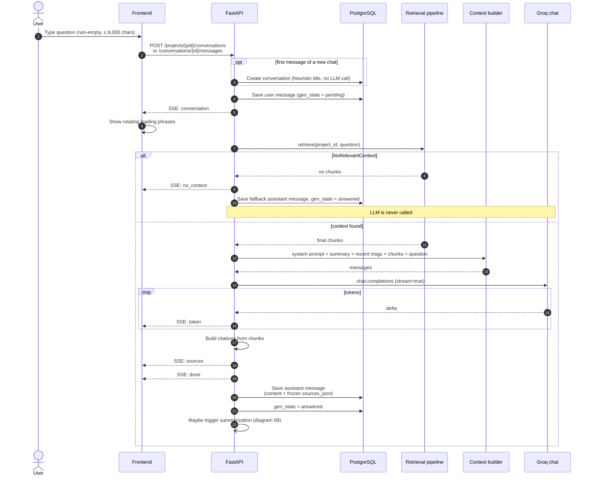

# 06 — Chat Answer Streaming Sequence

Happy path and no-context path. Source: Plan → Backend Behaviour §6–7; Phases 7–8.

**Rules**
- The user message is persisted before any retrieval or LLM work.
- The assistant message is persisted only after `done`.
- Event order: `conversation` → `token`* → `sources` → `done` | `no_context` | `error`.
