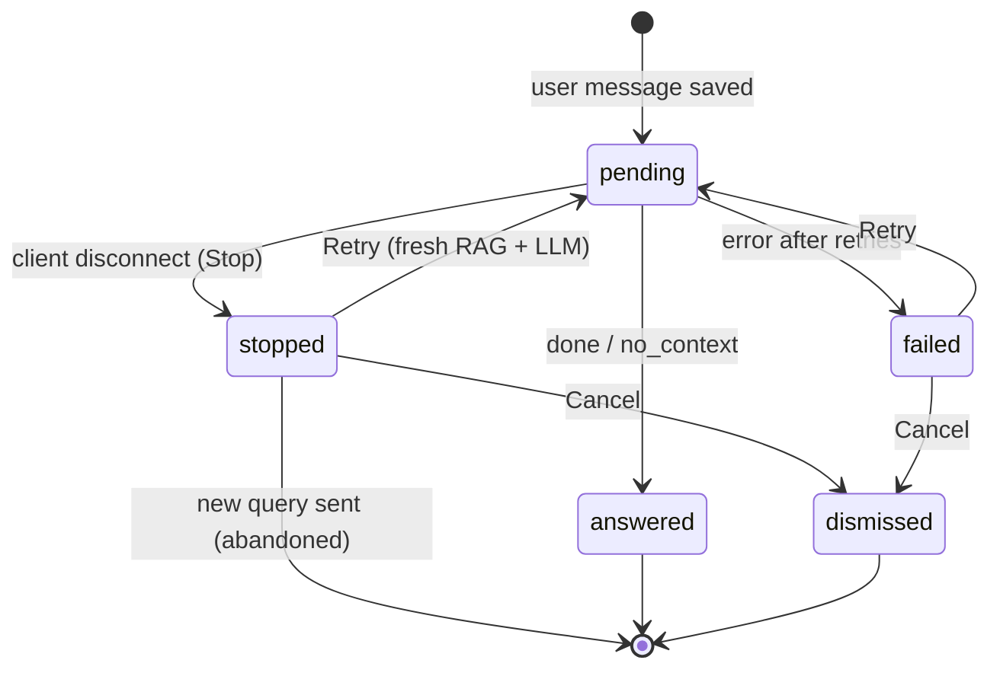
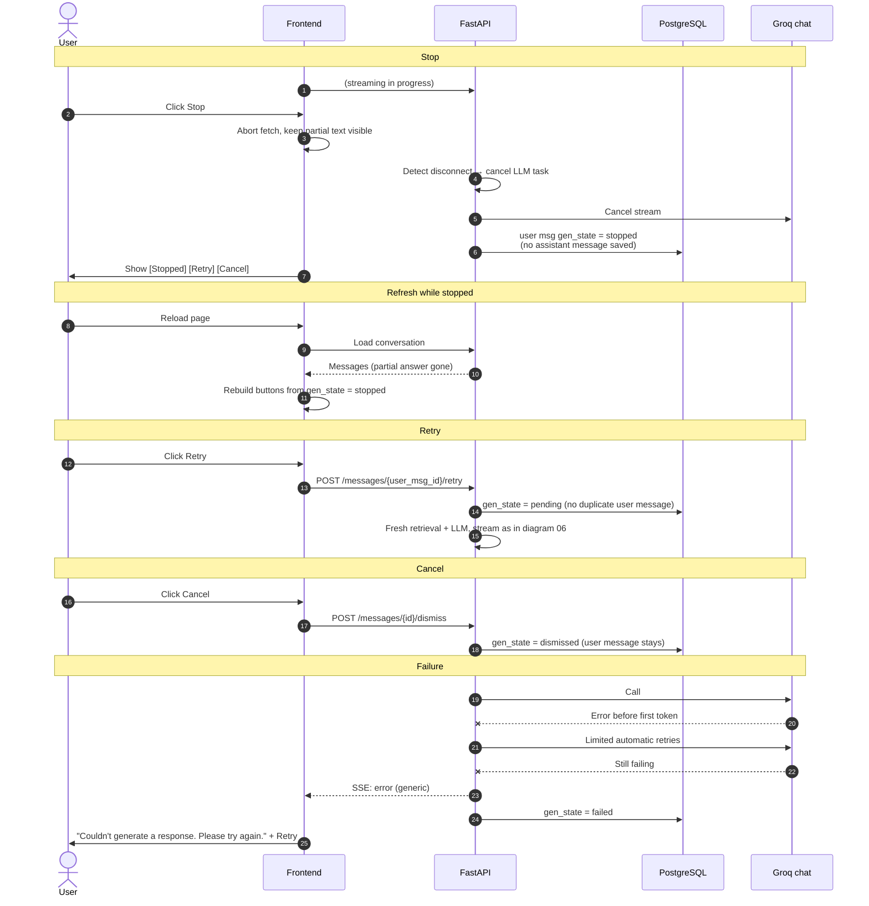

# 07 — Stop, Retry & Cancel

Interruption and failure handling. Source: Plan → Backend Behaviour §6; Phase 10.

## User-message `gen_state` machine

## Sequence

**Notes**
- Failure after the first token produces `error` directly, with no silent retry.
- An inactivity timeout and a max-output-token ceiling also apply.
- Provider error text never reaches the UI.
