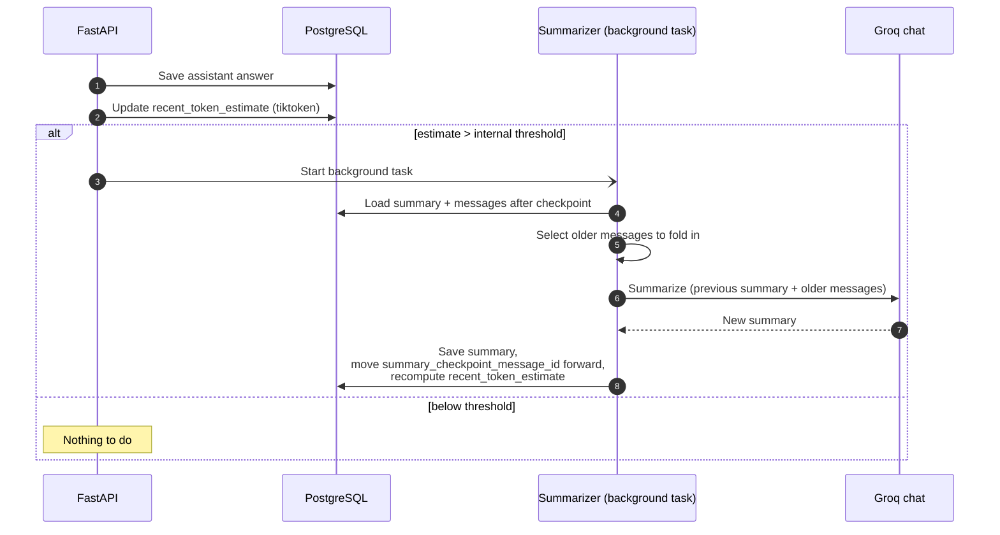
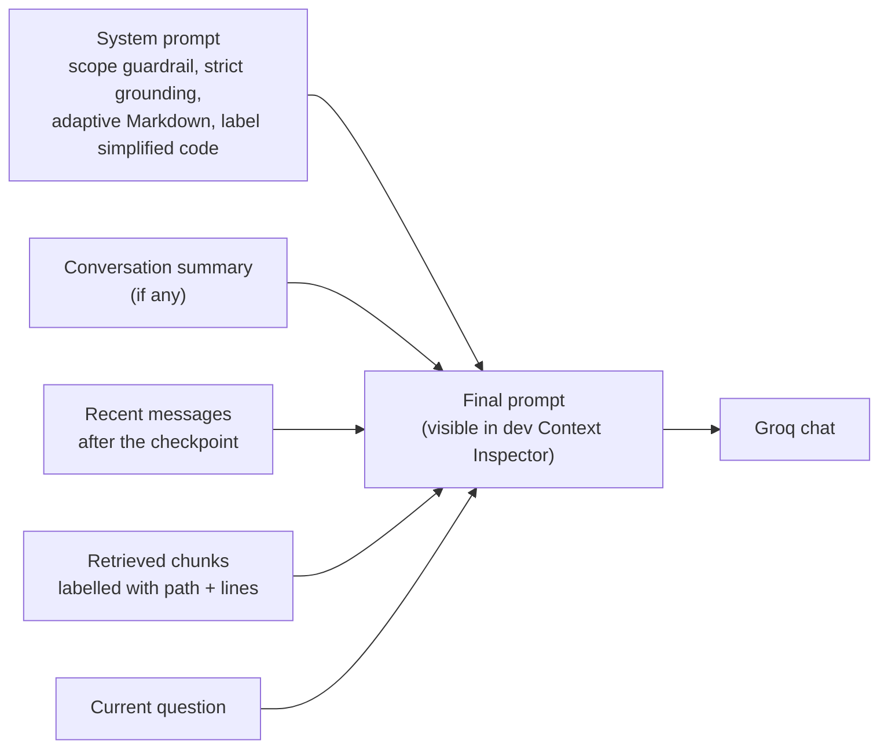

# 09 — Conversation Summarization & Context Assembly

Keeps prompts small as chats grow. Source: Plan → Backend Behaviour §6; Phase 9.

## Summarization trigger

## What the LLM receives

**Notes**
- Summarization never blocks the answer stream.
- Deleting a conversation removes its messages only; project files and chunks are untouched.
