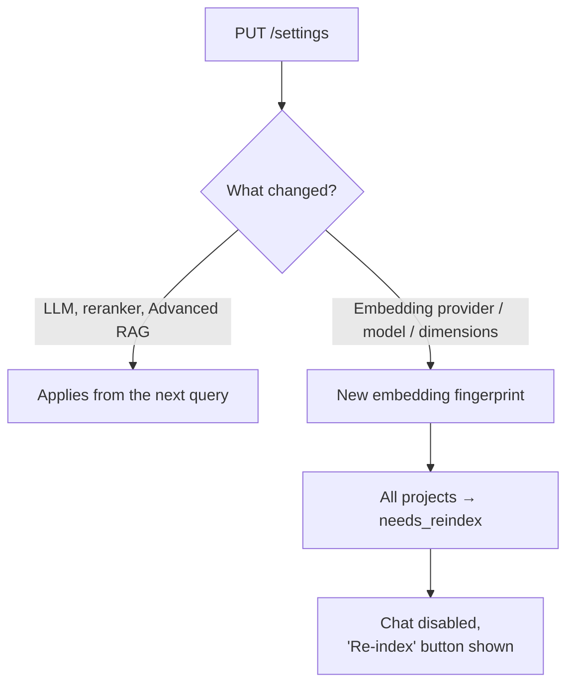
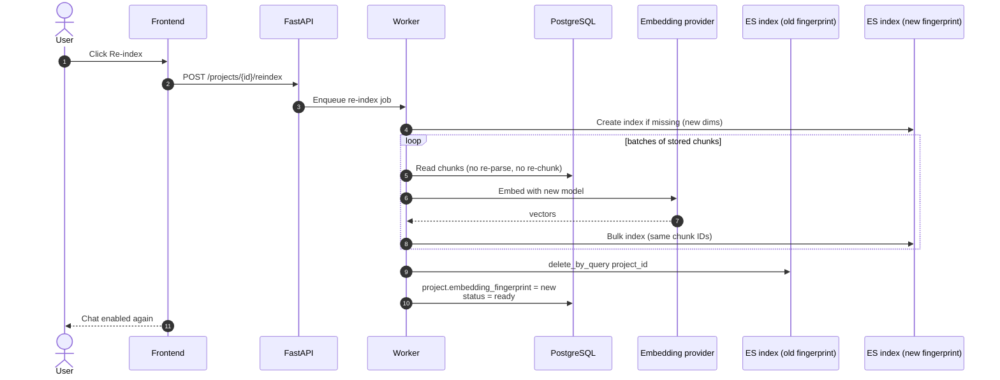
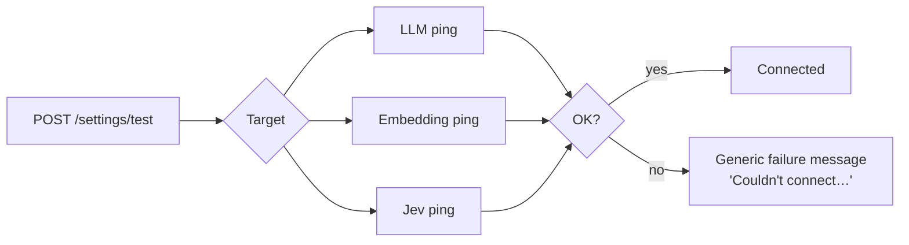

# 10 — Settings Change & Re-index

What happens when settings change, especially embeddings. Source: Plan → Backend Behaviour §9; Phase 11.

## Which settings apply when

## Re-index sequence

## Test connection

**Notes**
- API keys are stored Fernet-encrypted, returned masked, and the visibility toggle works only for keys just typed.
- Unsaved changes are discarded when leaving the Settings page.
