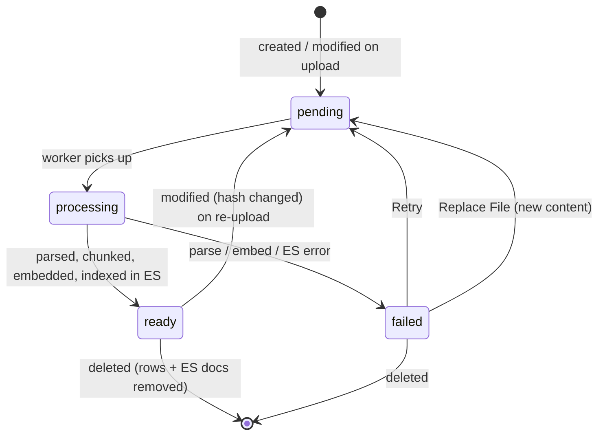
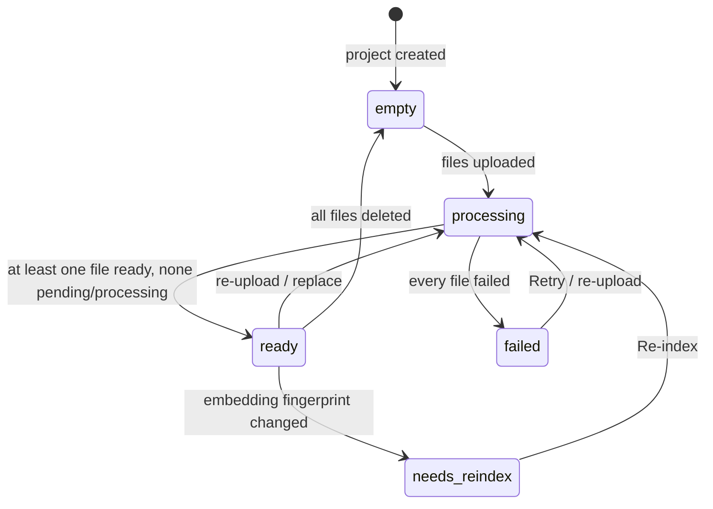

# 11 — File & Project Status Lifecycle

Source: Plan → Data Model, Backend Behaviour §1–2; Phase 4.

## File status

## Project status

**Notes**
- Project status is derived from file statuses; it is not set independently.
- Chat is enabled only when at least one file is `ready` and the project is not `needs_reindex`.
- Only `ready` files are retrievable.
