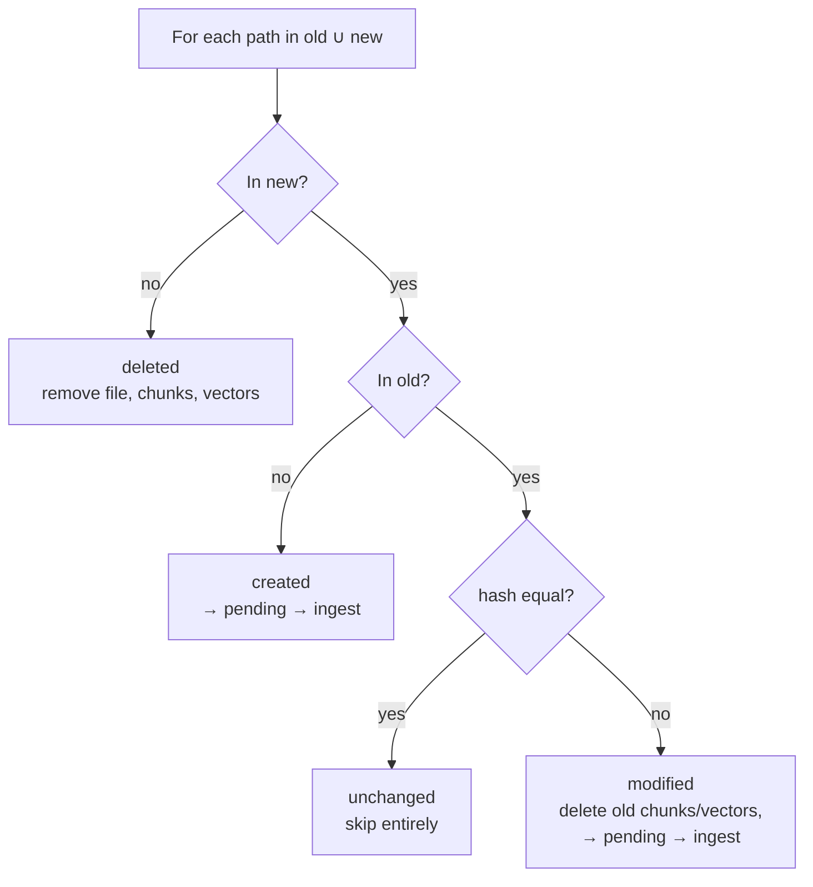
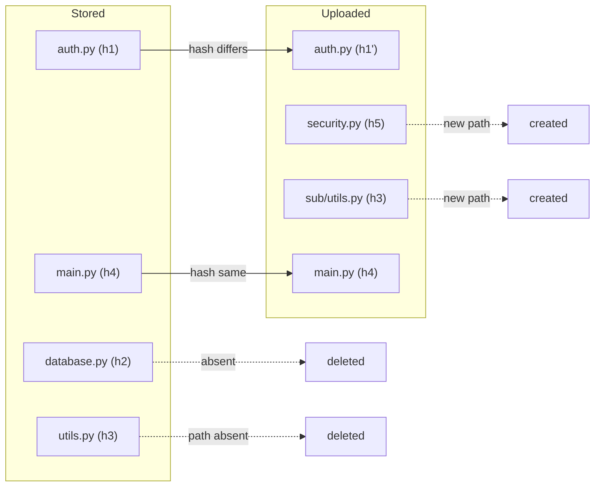

# 12 — Change Detection

`diff(old: {path: hash}, new: {path: hash}) -> {created, modified, deleted, unchanged}`. Pure function, no I/O. Source: Plan → Backend Behaviour §1; Phase 3.

## Worked example (Phase 3 proof)

| Action on `samples/ecommerce-demo` | Result |
|---|---|
| Edit `auth.py` | modified |
| Delete `database.py` | deleted |
| Add `security.py` | created |
| Move `utils.py` → `sub/utils.py` | `utils.py` deleted + `sub/utils.py` created |
| Everything else | unchanged |

**Notes**
- A rename or move is always delete + create (no content-based rename detection).
- Hashing streams each file in 1 MB blocks (SHA-256).
- `PUT /files/{id}` with an identical hash skips processing.
