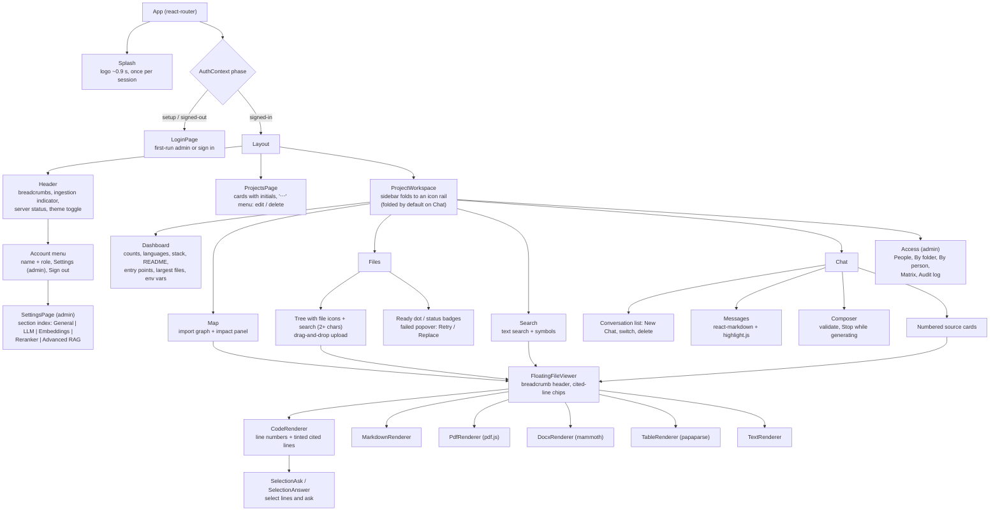
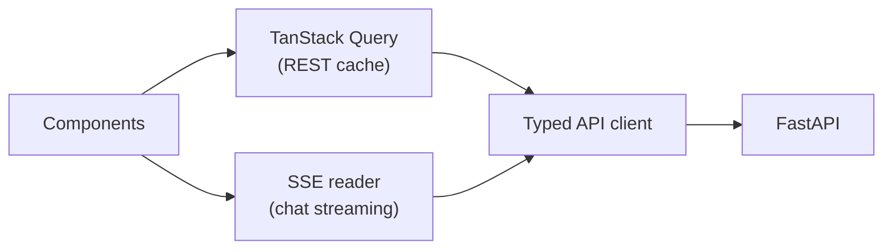
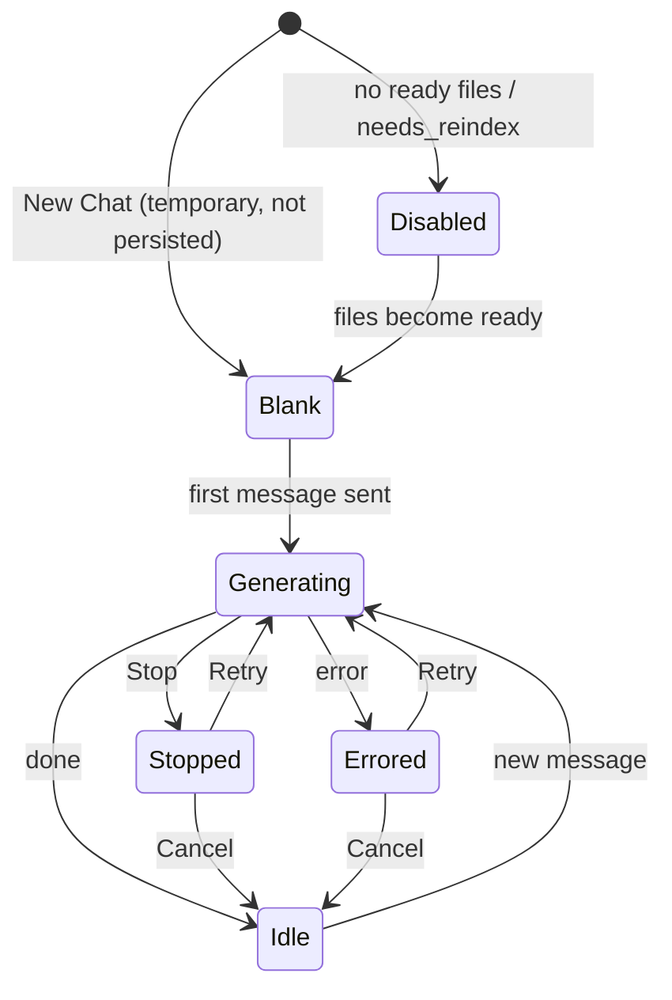

# 13 — Frontend Structure

Source: Plan → Frontend and Repository Layout; visual rules in [Frontend-Design.md](../Frontend-Design.md). Updated 2026-11-08.

## Routing and layout

## Data flow

## Chat tab states

