# 14 — Phase Roadmap

Delivery order for phases 0–12; each ends with a proof review. Source: [Phases.md](../Phases.md).

## Dependencies

```mermaid
flowchart TD
    P0["0 Foundation<br/>docker, /health, shell, splash"] --> P1["1 Project Management"]
    P1 --> P2["2 Upload, Filtering, Explorer"]
    P2 --> P3["3 Change Detection, Re-upload, Overview"]
    P3 --> P4["4 Parsing, Chunking, Background Ingestion"]
    P4 --> P5["5 Embeddings, ES Indexing, Isolation"]
    P5 --> P6["6 Hybrid Retrieval + Eval"]
    P6 --> P7["7 Chat with Streaming RAG"]
    P7 --> P8["8 Citations & Source Navigation"]
    P8 --> P9["9 Conversation Mgmt & Memory"]
    P9 --> P10["10 Interruption & Resilience"]
    P10 --> P11["11 Settings, Re-index, Jev"]
    P11 --> P12["12 Hardening & V1 Acceptance"]

    P4 -. "Chunk Inspector" .-> D1(["dev tool"])
    P5 -. "Playground v1" .-> D2
    P5 -. "ES Inspector" .-> D5(["dev tool"])(["dev tool"])
    P6 -. "Playground v2" .-> D2
    P9 -. "Context Inspector" .-> D3(["dev tool"])
    P10 -. "FAULT_LLM / FAULT_RETRIEVAL" .-> D4(["dev flags"])
```

## Timeline by theme (ordering only, not durations)

```mermaid
gantt
    title DevDocs V1 phases (relative order)
    dateFormat X
    axisFormat %s
    section Foundation
    0 Foundation                 :done, p0, 0, 1
    1 Project Management         :done, p1, after p0, 1
    section Ingestion
    2 Upload & Explorer          :done, p2, after p1, 1
    3 Change Detection           :done, p3, after p2, 1
    4 Parsing & Chunking         :p4, after p3, 1
    5 Embeddings & ES            :p5, after p4, 1
    section Retrieval
    6 Hybrid Retrieval + Eval    :p6, after p5, 1
    section Chat
    7 Streaming RAG Chat         :p7, after p6, 1
    8 Citations                  :p8, after p7, 1
    9 Conversations & Memory     :p9, after p8, 1
    10 Resilience                :p10, after p9, 1
    section Finish
    11 Settings & Re-index       :p11, after p10, 1
    12 Hardening & Acceptance    :p12, after p11, 1
```



## Spec → phase coverage

| Spec | Phases |
|---|---|
| 1 Document Ingestion | 2, 3, 4, 5 |
| 2 Project / Workspace Management | 1, 3, 5 |
| 3 Chat Interface | 7, 9 |
| 4 Document Explorer | 2, 4 |
| 5 Search & Retrieval | 5, 6 |
| 6 RAG Answer Generation + Guardrails | 7, 9, 10 |
| 7 Citations & Source Display | 8 |
| 8 Error / Loading / Empty States | 1, 4, 7, 10, 12 |
| 9 Settings & Configuration | 11 |
