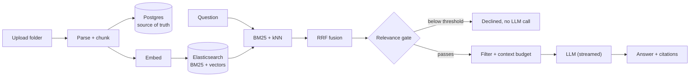

# DevDocs

**Chat with your codebase. Get grounded answers with exact, clickable citations.**

DevDocs is a project-scoped retrieval-augmented assistant for software projects. Upload a project folder, and DevDocs indexes it incrementally and lets you ask questions about the code and documentation. Every answer is grounded in your files and links back to the exact lines it came from. Questions the project cannot answer are declined instead of guessed.

It runs locally, for a single user.

## Highlights

- **Grounded answers with citations.** Sources are built by the application, not the model, so they cannot be invented. Click one to open the file with the cited lines highlighted.
- **Hybrid retrieval.** Keyword search (BM25 over content, path and headings) and vector search are fused with Reciprocal Rank Fusion, then gated on relevance.
- **Honest refusals.** A relevance gate declines off-topic questions without calling the LLM, which saves tokens and prevents fabricated answers.
- **Incremental ingestion.** SHA-256 change detection re-processes only what changed, and unchanged chunks keep their embeddings.
- **Rate-limit aware.** Client-side rate limiting, real token accounting, and automatic routing to a secondary model when the primary's per-minute budget is spent.
- **Resilient chat.** Streaming responses, Stop / Retry / Cancel, silent retries, conversation memory with background summarisation.
- **Configurable at runtime.** Models, providers, keys and retrieval tuning can be changed from the Settings page without a restart.

## Features

| Area            | What you get                                                                                                                                                     |
| --------------- | ---------------------------------------------------------------------------------------------------------------------------------------------------------------- |
| Projects        | Create, rename, delete; per-project isolation of files, vectors and conversations                                                                                |
| Upload          | Folder upload with client- and server-side filtering (ignore list, supported types, size limits), re-upload with created / modified / deleted / unchanged report |
| Explorer        | Collapsible tree, name and path search, status badges, retry / replace / delete, floating viewer for code, Markdown, PDF, DOCX, CSV and text                     |
| Ingestion       | Background worker, parsers and structure-aware chunkers (Python by AST, Markdown by heading, PDF by page, and more), live progress                               |
| Chat            | Streaming Markdown answers, syntax-highlighted code blocks, conversation sidebar, follow-up questions, Stop / Retry / Cancel                                     |
| Citations       | Grouped by file in retrieval order, line ranges kept separate, deleted files handled gracefully                                                                  |
| Settings        | LLM, embeddings, reranker and retrieval tuning; API keys encrypted at rest; Test Connection; one-click re-index when embeddings change                           |
| Developer tools | Chunk Inspector, ES Inspector with vector peek, Retrieval Playground, chat Context Inspector, failure injection (toggle in Settings)                             |
| Status          | Live indicator for backend, database and search availability; ingestion progress in the header and project rail                                                  |

## How it works



1. A file becomes searchable only after its chunks are stored in Postgres and indexed in Elasticsearch.
2. Every query is filtered by project and by files that are ready, enforced on the server.
3. Chunks that survive the gate and filter are sent to the model with the question; sources are attached by the application.

## Retrieval and answer quality

Evaluated on a 428-question set built against a real 104-file project (answerable and off-topic questions), using a tuning split and a separate held-out split.

Each cell shows two values: **tuning set / held-out set**.

- **Tuning set**: the questions used to choose the pipeline's thresholds and settings. Scores here are the optimistic side.
- **Held-out set**: a separate set written afterwards in a different style (casual, typos, vague wording), with the thresholds fixed beforehand. It is the closer indicator of how the system behaves on new questions.

The baseline is the hybrid pipeline before path-aware keyword search, the test-file prior and follow-up resolution.

| Metric                                       | Baseline pipeline (tuning / held-out) | Optimised pipeline (tuning / held-out) |
| -------------------------------------------- | ------------------------------------- | -------------------------------------- |
| Hit rate (a relevant file is in the context) | 0.93 / 0.94                           | **0.94 / 0.94**                        |
| Recall@5                                     | 0.83 / 0.89                           | **0.87 / 0.92**                        |
| MRR (rank of the first relevant file)        | 0.78 / 0.71                           | **0.83 / 0.79**                        |
| Off-topic questions declined                 | 0.93 / 0.84                           | 0.93 / 0.84                            |

Design decisions backed by measurement:

- **Relevance gate on vector similarity** separates answerable from off-topic questions better than a cross-encoder reranker (AUC 0.99) and costs nothing extra, so the reranker is optional and off by default.
- **Path- and heading-aware keyword search** and a **test-file prior** lift ranking quality without changing the gate.
- **Follow-up resolution** adds the previous question to the search text only when a question refers back to it.

## Performance

Measured end to end on a laptop against the live providers (single runs; provider latency varies by about a second).

|                                             |                                                                                                         |
| ------------------------------------------- | ------------------------------------------------------------------------------------------------------- |
| Retrieval (query embedding, search, fusion) | 0.5–0.8 s, and tens of milliseconds for a repeated question                                             |
| First token                                 | about 1 s on the smaller model, 1.5–3.5 s on the larger one                                             |
| Burst of questions inside one minute        | 1.6–2.0 s each, instead of a 40+ second stall, by routing to a secondary model with its own rate budget |
| Re-processing an edited file                | only changed chunks are re-embedded                                                                     |
| Frontend first load                         | 73 KB gzipped entry chunk; pages and the file viewer load on demand                                     |

Methodology, negative results and caveats: [Docs/Reports/Retrieval-Optimisation-Round-2.md](Docs/Reports/Retrieval-Optimisation-Round-2.md). Planned improvements: [Docs/Reports/Optimisation-Analysis.md](Docs/Reports/Optimisation-Analysis.md).

> The evaluation questions were written by the developer for one project, so treat the numbers as a guide, not a guarantee.

## Tech stack

| Layer          | Technology                                                                                                                                   |
| -------------- | -------------------------------------------------------------------------------------------------------------------------------------------- |
| Frontend       | React 18, TypeScript, Vite, Tailwind CSS, TanStack Query                                                                                     |
| Backend        | FastAPI, SQLAlchemy 2 (async), Alembic, Pydantic                                                                                             |
| Storage        | PostgreSQL 16 (source of truth), Elasticsearch 8 (BM25 and dense vectors)                                                                    |
| LLM            | Groq (`openai/gpt-oss-120b` by default, `openai/gpt-oss-20b` as fallback; OpenAI-compatible API); Gemini switchable. Runs on free-tier plans |
| Embeddings     | Google Gemini `gemini-embedding-001`, 1,536 dimensions, cosine                                                                               |
| Infrastructure | Docker Compose for Postgres and Elasticsearch                                                                                                |

## Run it on your machine

### Prerequisites

- Git, Docker Desktop (or Docker Engine with Compose), Python 3.11+, Node.js 18+
- An API key for the chat LLM provider and one for the embedding provider (see the Tech stack table)
- About 3 GB of free RAM for Elasticsearch

### 1. Clone and configure

```bash
git clone https://github.com/Shashank8602/DevDocs.git
cd DevDocs
cp .env.example .env        # Windows PowerShell: Copy-Item .env.example .env
```

Open `.env` and fill in the API key variables (names are listed in `.env.example`). Keys can also be set later in the app's Settings page.

### 2. Start the databases

```bash
docker compose up -d        # Postgres 16 + Elasticsearch 8
```

### 3. Start the backend

```bash
cd backend
python -m venv .venv

# Windows
.venv\Scripts\pip install -r requirements.txt
.venv\Scripts\alembic upgrade head
.venv\Scripts\uvicorn app.main:app --port 8000

# macOS / Linux
.venv/bin/pip install -r requirements.txt
.venv/bin/alembic upgrade head
.venv/bin/uvicorn app.main:app --port 8000
```

The API is at http://127.0.0.1:8000 (interactive docs at `/docs`, health at `/health`).

### 4. Start the frontend

```bash
cd frontend
npm install
npm run dev
```

Open **http://localhost:5173**.

### 5. Try it

1. Create a project.
2. Open **Files** and upload a folder (a sample is in `samples/ecommerce-demo/`).
3. Wait for the files to show **Ready**.
4. Open **Chat** and ask, for example, "How does authentication work?"

### Verify your keys

```bash
python scripts/check_providers.py
```

## Configuration

Defaults come from `.env`; the **Settings** page overrides them at runtime and stores API keys encrypted (`data/secret.key`, created on first use, never committed).

| Setting                                                        | Where                   | Notes                                                 |
| -------------------------------------------------------------- | ----------------------- | ----------------------------------------------------- |
| Provider, model, temperature, reasoning effort, fallback model | Settings → LLM          | Changes apply from the next question                  |
| Embedding model, dimensions, embedding key                     | Settings → Embeddings   | Changing the model marks projects "Re-index required" |
| Reranker                                                       | Settings → Reranker     | Optional, off by default                              |
| Gate, filter, Top-K, token budget                              | Settings → Advanced RAG | Defaults come from the evaluation                     |
| Developer mode                                                 | Settings → General      | Shows inspectors and failure injection                |

All environment variables are documented in [`.env.example`](.env.example).

## Project layout

```
backend/    FastAPI app (api, ingestion, retrieval, generation, providers), Alembic, evaluation harness
frontend/   React + Vite + Tailwind UI
scripts/    standalone tools (provider check)
samples/    demo projects
Docs/       plan, per-topic design notes, reports, diagrams
```

## Evaluation and maintenance

```bash
cd backend
.venv/Scripts/python -m eval.run                   # retrieval metrics on a project (needs the stack running)
.venv/Scripts/python -m app.search.reconcile       # remove index entries whose file no longer exists
.venv/Scripts/python -m app.search.backfill        # populate path/heading fields on an older index (no API calls)
```

## Documentation

|                                                                                                    |                                                                                 |
| -------------------------------------------------------------------------------------------------- | ------------------------------------------------------------------------------- |
| [Implementation plan](Docs/Plan/DevDocs-V1-Implementation-Plan.md)                                 | architecture, data model, behaviour per feature                                 |
| [Retrieval design](Docs/Plan/Retrieval.md)                                                         | pipeline, tuning, settings                                                      |
| [Backend file flow](Docs/Backend-File-Flow.md)                                                     | module order, dependencies, runtime flows                                       |
| [Implementation challenges](Docs/Impl_Clarifications/Phases-7-12-Implementation-and-Challenges.md) | problems met while building chat, memory and settings, and how they were solved |
| [Diagrams](Docs/Plan/Diagrams/README.md)                                                           | Mermaid diagrams                                                                |

## Troubleshooting

- **"No files are ready yet"**: ingestion runs in the background; watch the status badges in Files. Failed files can be retried or replaced.
- **A question waits before answering**: the provider limits tokens per minute per model. The chat shows the wait, and the fallback model absorbs bursts.
- **"Re-index required"**: the embedding settings changed. Use **Re-index** on the project banner; no re-upload is needed.
- **Embedding 429 errors**: the embedding provider's daily call limit was reached. Retry the failed files later.
- **Status indicator shows Offline or Degraded**: the backend, Postgres or Elasticsearch is not reachable; check `docker compose ps` and the backend terminal.

## Known limitations

- Single user, local only; there is no authentication.
- The Jev reranker adapter is a placeholder until its API details are available.
- The relevance gate value is tied to the embedding model and was calibrated on one project; re-run the evaluation after changing embeddings.
